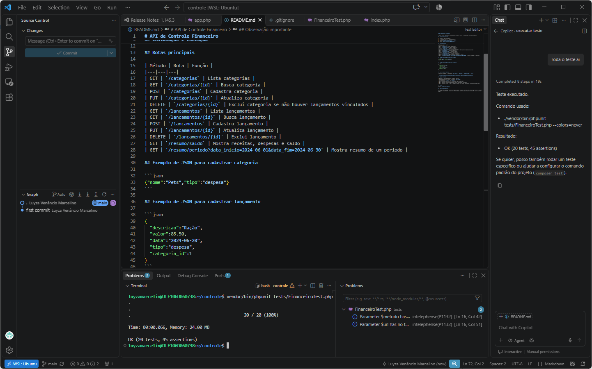

# API de Controle Financeiro
 
Projeto em PHP com Slim 4, mantendo a estrutura e o estilo de rotas usado no arquivo original.

## Como Clonar
Para clonar esse projeto, você deve entrar no aplicativo Windows PowerShell e digitar:

https://github.com/luyzaaaaav/controle.git
 
## Instalação e execução
 
1. Instale o PHP e o Composer.
2. No terminal, entre na pasta do projeto.
3. Execute `composer install`.
4. Execute `php -S localhost:8080 -t public`.
5. Acesse `http://localhost:8080/status`.
 
## Rotas principais
 
| Método | Rota | Função |
|---|---|---|
| GET | `/categorias` | Lista categorias |
| GET | `/categorias/{id}` | Busca categoria |
| POST | `/categorias` | Cadastra categoria |
| PUT | `/categorias/{id}` | Atualiza categoria |
| DELETE | `/categorias/{id}` | Exclui categoria se não houver lançamentos vinculados |
| GET | `/lancamentos` | Lista lançamentos |
| GET | `/lancamentos/{id}` | Busca lançamento |
| POST | `/lancamentos` | Cadastra lançamento |
| PUT | `/lancamentos/{id}` | Atualiza lançamento |
| DELETE | `/lancamentos/{id}` | Exclui lançamento |
| GET | `/resumo/saldo` | Mostra receitas, despesas e saldo |
| GET | `/resumo/periodo?data_inicio=2024-06-01&data_fim=2024-06-30` | Mostra resumo de um período |
 
## Exemplo de JSON para cadastrar categoria
 
```json
{"nome":"Pets","tipo":"despesa"}
```
 
## Exemplo de JSON para cadastrar lançamento
 
```json
{
  "descricao":"Ração",
  "valor":85.50,
  "data":"2024-06-20",
  "tipo":"despesa",
  "categoria_id":1
}
```
 
## Filtros de lançamentos
 
É possível combinar os parâmetros `data_inicio`, `data_fim`, `categoria_id` e `tipo`:
 
`/lancamentos?data_inicio=2024-06-01&data_fim=2024-06-30&tipo=despesa&categoria_id=1`
 
## Regras aplicadas
 
- O valor do lançamento precisa ser maior que zero.
- A data deve existir e estar no formato `AAAA-MM-DD`.
- O tipo deve ser `receita` ou `despesa`.
- A categoria precisa existir e ter o mesmo tipo do lançamento.
- Não é permitido cadastrar duas categorias com o mesmo nome.
- Não é permitido excluir categoria que possua lançamentos vinculados.
- Não é permitido trocar o tipo de categoria quando isso tornar lançamentos existentes incompatíveis.
 
## Testes
 
Execute `vendor/bin/phpunit`.
 
## Observação importante
 
Os dados estão guardados em arrays, como no projeto original. Portanto, são dados temporários: ao reiniciar a aplicação, as alterações feitas pela API voltam aos dados iniciais. O projeto ainda não utiliza banco de dados.
  
 
